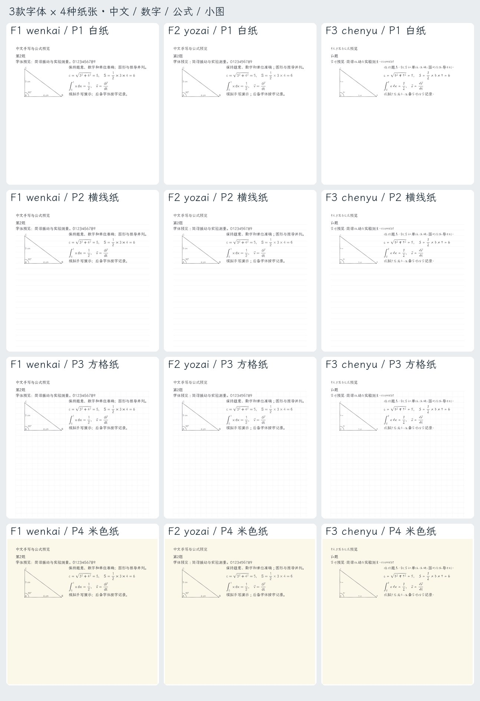
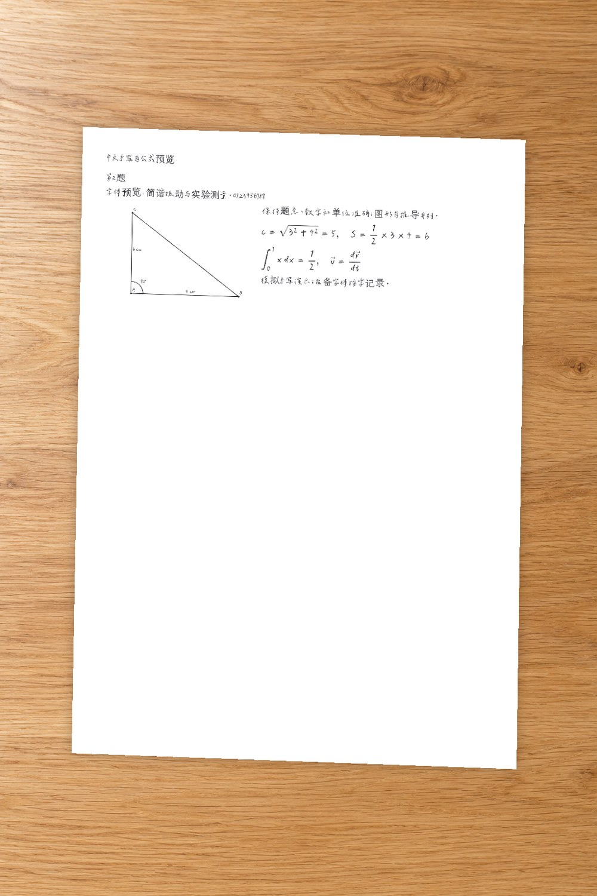

# 字体与纸张实生成样张

以下均为本项目自编内容的模拟手写效果，不是真实学生作答或真实拍摄的作业。
每张包含中文、数字、结构化公式和三角形小图。



总览每列依次为 F1 文楷、F2 悠哉、F3 辰宇落雁体；每行依次为 P1 白纸、
P2 横线纸、P3 方格纸、P4 米色纸。单张预览以 `F编号-P编号-字体-纸张.jpg`
命名，可放大查看。全部样张启用 `handwriting: natural`，正文采用所选字体并加入
轻微逐字变化。公式的分式、根号、上下标、伸缩括号及特殊数学符号保留 MathJax
结构和定位；常见数字、拉丁字母和运算符使用所选字体轮廓。

样张墨色为 `#202126`，启用 `ink_effect: ballpoint`：在笔迹内部模拟连续压力带来
的覆盖率起伏，并结合落点纸面颜色融合墨迹。这个笔墨层属于程序模拟，保留
原有字形和公式位置，不是实际书写或真实圆珠笔测试。

辰宇落雁体缺少的简体字逐字采用文楷，并在 `manifest.json` 中记录。
该字体的原始 TrueType hint 在已测试 FreeType 中报错；渲染器仅为内存副本去除
失效 hint，原始字体文件与 SHA-256 均不改变，调整也记录在清单中。



拟真预览使用辰宇落雁体与自然手写模式，把纸面合成到项目内明确标识的 AI 背景上；这是程序合成效果，
四个纸角完整可见，生成器没有调用外部图像 API。准确模式的原始高清 PNG、PDF
应由实际 `render` 输出保留，图库 JPEG 仅用于选择样式，不能代替上传前核对。

在仓库根目录重新生成：

```powershell
& .\.venv\Scripts\python.exe scripts/make_samples.py --photo-background assets/backgrounds/desk-oak.png
```

`--photo-background` 也可传入用户授权的现有本地图片。不传时只生成准确模式样张；
`examples/photo-profile.json` 不包含不存在的背景路径占位。重建自编题单与练习册
源页而不生成图库可使用 `--fixtures-only`。

生成器用精确有理数、符号求导/积分、矩阵乘法和反例核对示例答案，再执行题单
完整性检查。这些记录仅对应自编示例，不能复用为任何真实作业的复核证明。
